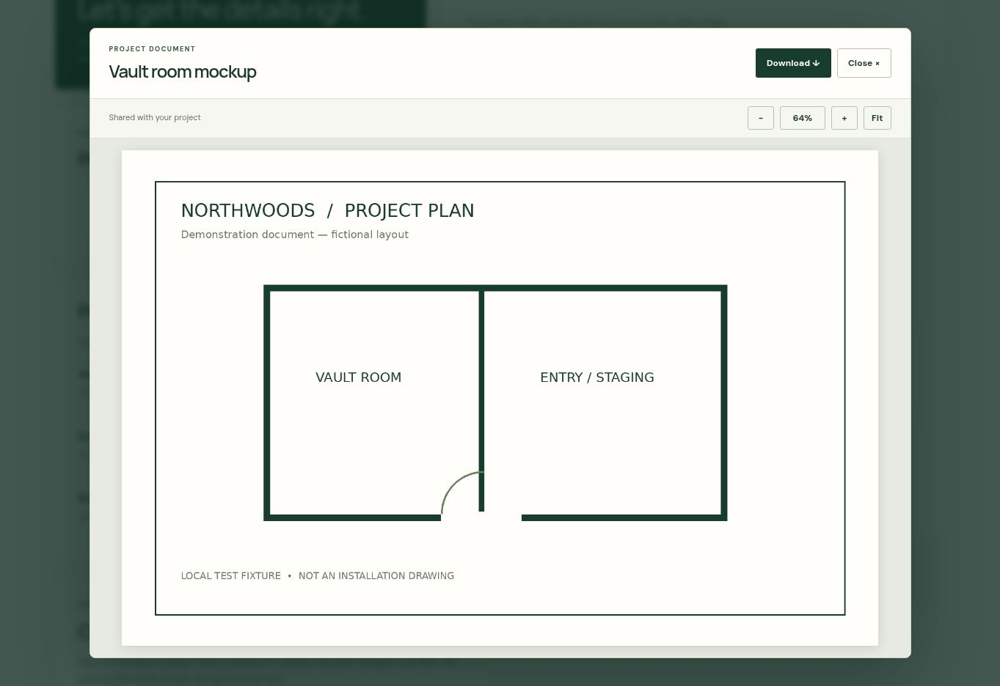

# Document viewer

The current project document flow prepares a short-lived link that forces a download. This change replaces it with **View document**, opening a viewer inside the customer portal and owner dashboard. The viewer includes **Download**, **Close**, image zoom, actual size, and fit-to-screen controls.

## What is included

- PNG and JPEG image previews, plus PDF previews using the browser's PDF viewer.
- Downloads with readable filenames, available from the loaded file while the viewer remains open.
- Responsive layout, native modal keyboard containment, Escape to close, and focus returned to the original View button.
- Loading feedback, a 20-second request deadline, retry, and protection against late responses after closing or switching documents.
- Blob URLs and pending requests are released on close, project changes, sign-out attempts, and page exit. No file is written to browser storage by the application.
- Updated portal privacy text explaining preview retrieval and optional local downloads.

## Access and implementation

`document-viewer.js` provides one shared viewer. `portal.js` and `admin.js` open it from each document row. `portal-api.js` requests the existing authorized, 60-second signed URL from the private `project-documents` bucket and retrieves the bytes without browser credentials, redirects, or persistent fetch caching. Only the configured Supabase origin, the exact private document path, and matching PDF/PNG/JPEG content types are accepted. Empty or over-10-MiB responses are rejected.

The viewer renders a local blob rather than exposing the signed URL in the interface. `_headers` permits blob PDF frames on hosts that support that file, including Cloudflare Pages. The current GitHub Pages host does not apply `_headers`; no new response-header enforcement is claimed for that host. Authentication, database row-level security, bucket privacy, file upload types, and existing customer records are unchanged. No external viewer, new service, database migration, or secret is required.

GitHub Pages uses its Jekyll build for this repository. `_config.yml` excludes tests, fixture documents, review images, backend scripts, and setup notes from that published site. The separate `build.cjs` output also excludes these files.

## Validation

- `npm test --prefix tests`: **70 passed, 0 failed**. All API responses are mocked.
- `python tests/check-site.py`: **13 HTML pages, 9 JavaScript files, no errors**, including build output and script ordering.
- `git diff --check`: passed.
- Browser checks with fictional local documents: customer and owner image previews, image zoom/fit, actual completed download, PDF rendering under the proposed CSP, failed-load retry, Escape/focus restoration, and a 390 × 844 layout with no horizontal dialog overflow.
- Tests cover unsafe URLs, mismatched file types, expired/failed responses, empty/oversized files, timeouts, retry, stale responses, safe labels, filenames, and resource cleanup.
- Added end-to-end application-code tests using real PNG, JPEG, and PDF fixtures: original File → upload API → project document metadata → private retrieval → viewer/download blob. Byte comparisons and SHA-256 checks confirm the file contents stay identical. Same-named uploads are tested independently, including selecting them in reverse order and switching back.
- Confirmed the production build loads the real document API and excludes all demonstration fixtures. No placeholder drawing is included in the viewer.
- Corrected zoom-out behavior for large images that fit below 10% on a small screen; a 6000-pixel image in a 390-pixel viewport now shrinks correctly.

PDF preview depends on the device's built-in PDF support; Download remains available if it cannot render. A live authenticated storage fetch and mobile Safari have not been tested. No live documents, inquiries, messages, or customer accounts were created or changed.

## Release status

Prepared on `review/document-viewer`, based on `origin/main` at `5b006a45ae2d381218b99542db0c434818d05ec4`. This branch is independent of the pending account-loading fix and public inquiry proposal. The owner approved publishing this document viewer after reviewing the implementation and mocked tests. Deployment uses the existing GitHub Pages setup; it does not enable public inquiry submissions.

